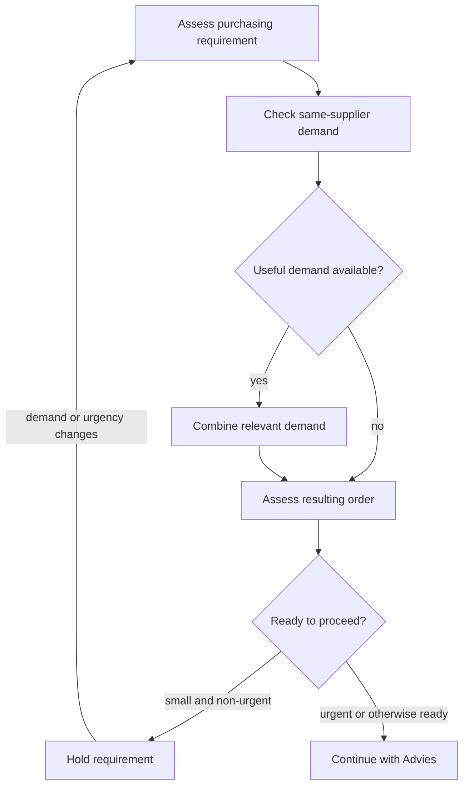

# Operational purchasing: AS-IS process

Consolidated from the V1.5 process reference, whose presentation was corrected on 8 September and scope annotated on 7 October 2026. This file owns observed workflow, stable Task IDs and unresolved process facts. [Project](PROJECT.md) owns scope, [Methods](METHODS.md) owns measurement rules, the [Arno notebook](../Arno_Analysis_2026_10_02.ipynb) owns workload results, and the [selection notebook](../Focal_Case_Selection_2026-10-07.ipynb) owns candidate decisions. Earlier opportunity profiles are historical interpretation, not current rankings.

## Scope and evidence

The buyer-side map runs from purchasing need through `Bevestigd`, including interruptions, supplier-unavailability exceptions and Finance-returned investigations. `Ontvangen → Gefactureerd → Betaald` remain outside detailed mapping except where they cause purchasing rework. Observing this wider context does not make all of it eligible for improvement: logistics remains outside thesis scope; former EXC stays visible under OTHER but outside improvement under the 1 October rule. Dennis supplies separate purchasing context, not additional Arno observations.

The model combines August 17, 19, 20, 21, 28 and 31 and September 1 evidence, employee explanations, the [21 August buyer walkthrough](../evidence/meetings/Internship_notes_2026-08-21.md), and the received SOP/work-instruction package. August 21 chiefly provided validation and documentary grounding, rather than another detailed shadowing day.

| Evidence label | Meaning |
|---|---|
| Formal | Explicit support at the relevant level in a received SOP/work instruction |
| Observed | Directly seen during shadowing |
| Stated | Explained by an employee |
| Buyer-validated | Confirmed/corrected during the 21 August walkthrough |
| Single case | One case, not a representative average |
| Open | Evidence remains missing |

The [company-document register](../evidence/company/Official_Document_Register_2026-08-21.md) identifies the formal sources and limits. High-level SOP silence about a detailed activity is not evidence of non-compliance. The SOP requires authorized ERP POs and archiving received confirmations; it does not establish every observed Exact action. Formal supplier control belongs to Procurement management with QA involvement. Supplier selection is not normally a recurring Arno decision, although it occurs in Dennis's wider role.

Week-1 durations below are observer estimates of single-case **elapsed time**, recorded before the measurement protocol. They were not clock-measured, may contain task switching and are not active-time standards. This limitation was corrected on 30 September in the [20 August record](../evidence/meetings/Internship_notes_2026-08-20.md).

## Connected workflow and control points

External requests, Exact demand and open POs enter one purchasing workflow. Existing work resumes at its relevant stage. Requests arrive through email, phone, desk contact, screenshots or colleagues and may require clarification, historical investigation or manual transfer. An answer, referral or waiting request need not create a PO. On 1 September, when no open PO or external request required attention, Arno generated a new PO record from Exact demand. This observation does not establish a complete priority rule between all work types.

The buyer validates article, machine, serial, service and supplier information and may search historical POs when something looks suspicious. Stock assessment considers stock, safety stock, future demand, open POs, expected receipts, lead time, urgency, project/production needs and supplier MOQ/minimum requirements. These activities combine investigation and purchasing judgement.

The maximalisatie sequence separates consolidation from the later order decision:

Checking MAX as a normal part of **each** order remains a researcher interpretation from 31 August, not separately recorded universal buyer validation. The historical validation annotation `MAXOBS=Y`, none, or `?` records whether a check was observable in a PO episode. Whether demand was added and whether the resulting order was held are separate outcomes. MAX and PO work can occur seamlessly; do not invent separate durations. Size, urgency, MOQ/minimum value and current purchasing context inform the hold/proceed judgement.

The buyer-validated sequence is `Advies → Toewijzen → relevant pre-PO price check/correction → prepare/complete supplier PO`. `Advies` requires interpretation of underlying demand; its calculation remains unknown. `Toewijzen` assigns quantity to project/production demand. A missed assignment can leave demand unresolved and create duplicate-purchase risk. One combined Advies/MAX/Toewijzen case was estimated at 30–35 elapsed minutes, including switching; it does not isolate any component.

**Before release**, certain one-off/special purchases involve comparing current supplier prices with stored Exact prices and correcting outdated values. Otherwise a stale value can remain available for reuse until a later confirmation. Whether services routinely receive this check is unresolved. This is distinct from **after-confirmation** control against the issued PO/Exact.

The buyer prepares the PO from selected or consolidated demand and checks authorization. The stated normal limit is approximately €10,000. Johan explained on 21 August that above-authority orders go to Dennis's or Johan's email for `Fiatteren`; routing, recording and continuation still lack a traced case. The [2 October attributed account](../evidence/working/Arno_Follow_Up_Session_Guide_2026-10-02.md#what-yijie-reported-on-2-october) additionally reports renewed Johan approval after any Exact change above that limit. Dennis's [15 September note](../evidence/meetings/Internship_notes_2026-09-15.md#17-po-issue-and-approval-access) records lack of `fiatteren` access, so the August route is not a verified current permission matrix.

A generated PO record appeared as `Besteld` on 1 September and became open PO work. **`Besteld` does not prove supplier dispatch or receipt.** Later, after the relevant `Fiatteren`/`Verrichten` path, Exact generates the supplier-facing PO document and emails the buyer in Outlook. The buyer checks/selects the recipient, adds a standard message and forwards it. Earlier automatic emailing was reportedly unreliable, including because supplier contact details changed.

After a supplier confirmation arrives, the buyer compares relevant information with the PO/Exact, corrects deviations, attaches/archives the confirmation and sets `Bevestigd`. Checking and attachment are distinct work. Finance can subsequently return a possible issue, prompting investigation across Exact, PO, confirmation, invoice and Outlook. Return frequency and root causes are unquantified. If a component is unavailable, the buyer searches alternatives and may remove the unavailable line to avoid falsely showing the need as ordered. How the unresolved need remains visible is unknown.

Email, colleagues, supplier/project requests and other work during Exact waits interrupt this sequence. Active handling, elapsed case time and waiting must remain distinct. IT stated that Exact Globe+ is accessible through Orbis; accessible fields, read/write scope and integration feasibility are not established by that statement.

## Stable task inventory

IDs identify work and branch outcomes; they are not a strict chronological sequence. Use the [activity framework](reference/Purchasing_Activity_Framework_2026-09-21.md) and reviewed row-level stages for classification. Type: **A** administrative/repetitive; **B** judgement/investigation; **C** process/information/control issue; **V** verification/comparison. “Not assigned” preserves the source's empty-type marker for Task 25. Basis distinguishes Formal requirements, observed System behavior, Observed practice and stated Company control. Company control is only partly supported by the formal authorization requirement.

| # | Step / task | Actor | Type | Current evidence | Basis | Main unknown / measurement need |
|---|---|---|---|---|---|---|
| 1 | Receive / identify purchasing need through Exact or external request | Requester / Buyer | C | **Observed + Formal high-level** | Formal + observed practice | Frequency/share by route |
| 2 | Create purchasing entry / PO lines in Exact for an external request | Buyer | A | **Observed; single case, estimated ~5 min elapsed for 2 service lines** | Formal ERP PO requirement + observed practice | Frequency + representative active time |
| 3 | Transfer information from screenshot / email / colleague request into Exact | Buyer | A | **Observed** | Observed practice; article-management responsibility formally supported | Frequency + fields commonly transferred |
| 4 | Validate supplied article / machine / service information | Buyer | B | **Observed** | Observed practice + WI article-management context | Frequency + error/incompleteness categories |
| 5 | Search historical POs to resolve suspicious information when validation raises doubt | Buyer | B | **Observed; single case, estimated ~10–15 min elapsed** | Observed practice | Frequency + representative active time |
| 6 | Assess stock, future demand, open POs, receipts, lead time and urgency | Buyer | B | **Observed + Formal high-level inputs** | Formal + observed practice | Data availability + relative importance of inputs |
| 7 | Check additional same-supplier demand for maximalisatie as part of normal order processing | Buyer | B+A | **Observed; process interpretation clarified 31 Aug** | Observed practice | Search method, frequency, information sources + active time |
| 8 | Determine whether useful same-supplier demand is currently available for consolidation | Buyer | B | **Observed** | Observed practice | Decision criteria for what counts as useful consolidation |
| 9 | If useful demand is available, combine the relevant same-supplier demand; the resulting order still proceeds to the post-MAX hold/proceed assessment | Buyer | B+A | **Observed; single case, estimated ~4 min elapsed for one added item** | Observed practice | Frequency + amount/value combined + representative active time |
| 10 | After MAX, whether or not demand was added, assess whether the resulting order is small/non-urgent or otherwise ready to proceed | Buyer | B | **Observed; process interpretation clarified through 1 Sep** | Observed practice | Decision rules/cues for size + urgency |
| 11 | If the resulting post-MAX order is small and non-urgent, hold/pause it; otherwise proceed with ordering | Buyer | B | **Observed; process interpretation clarified through 1 Sep** | Observed practice | Hold frequency + proceed/hold outcome + reconsideration trigger |
| 12 | Review Exact `Advies` and underlying demand | Buyer | B | **Observed; sequence buyer-validated 21 Aug** | System + observed practice | Calculation logic + frequency + override behaviour |
| 13 | `Toewijzen` purchased quantity to underlying project/production demand | Buyer | A+B | **Observed; sequence buyer-validated 21 Aug** | System + observed practice | Miss/failure frequency + active-time split |
| 14 | Determine whether proactive pre-PO price check is required | Buyer | V+B | **Observed + Stated** | Observed practice | Frequency + whether services are included |
| 15 | Search current supplier price and compare with stored Exact price | Buyer | V+A | **Observed** | Observed practice | Active time by line count + data/API feasibility |
| 16 | Update pre-PO price in Exact when outdated/deviating | Buyer | A | **Observed** | Observed practice | Deviation frequency + update time |
| 17 | Prepare / complete supplier PO using the selected or already consolidated demand | Buyer | A+B | **Observed; sequence buyer-validated 21 Aug** | Formal PO requirement + observed practice | Frequency + workload contribution |
| 18 | Check whether order is within buyer authorization | Buyer | C | **Stated** | Company control + Formal authorization requirement | Frequency by value band; formal matrix if available |
| 19 | If within authority, perform `Fiatteren` / `Verrichten` | Buyer / Exact | A | **Observed + Stated** | System + Formal authorization/release requirement | Representative time; exact formal status mapping if needed |
| 20 | If above authority, route order to higher-authority approver for `Fiatteren` | Buyer / Approver | C+A | **Stated by manager, 21 Aug** | Company control | Routing trigger/rule + Exact/email recording + delay |
| 21 | Continue Exact workflow after higher-authority `Fiatteren` | Buyer / Approver / Exact | A+C | **Partly mapped** | Company control + System | Exact actor/action after approval |
| 22 | After release, Exact generates the supplier-facing PO document and emails the buyer | Exact / Outlook | A | **Observed + Stated** | System; Formal PO creation supported | Timing + automation details |
| 23 | Buyer forwards generated PO with standard supplier message | Buyer | A | **Observed + Stated** | Observed practice; placing PO with supplier is Formal | Daily volume + total effort |
| 24 | A newly generated PO record appears as `Besteld` in Exact and becomes open PO work; this status is distinct from manual supplier forwarding | Buyer / Exact | A | **Observed 1 Sep; current working model** | System + observed practice | Validate exact technical trigger/meaning if later analytically relevant |
| 25 | Supplier sends order confirmation | Supplier | Not assigned | **Observed + Formal if confirmation received** | External + Formal archiving requirement | Confirmation receipt rate / format variability if relevant |
| 26 | Compare supplier confirmation with PO / Exact | Buyer | V+A | **Observed; one large case, estimated ~30–40 min elapsed including task switching** | Observed practice | Active/elapsed time by line count + deviation rate |
| 27 | Correct relevant confirmation deviations in Exact | Buyer | A | **Observed** | Observed practice | Frequency + correction time |
| 28 | Attach/archive confirmation and set `Bevestigd` | Buyer | A | **Observed + Formal high-level confirmation archiving** | Formal + System + observed practice | Representative time / exact mailbox-system relationship if relevant |
| 29 | Finance performs later control and determines whether an issue exists | Finance | C+V | **Single observation + Stated** | Observed practice / downstream control | Detection method + issue frequency + cause categories |
| 30 | If Finance returns an issue, buyer investigates the returned case | Buyer | C+B | **Single observation + Stated** | Observed practice / downstream control | Investigation time + root causes + information needed |
| 31 | Handle a supplier-reported unavailable component: search for an alternative and remove the unavailable line if no alternative is found | Buyer | B+C | **Single observation** | Observed practice | How the unresolved need is tracked after removal |

### Historical mapping: Tasks 7–11

Historical observations retain their recorded IDs. The 31 August change altered both numbering and meaning; translate before comparison. The 28 August pilot uses the earlier numbering.

| Pre-31-August ID | Earlier meaning | Current ID / treatment |
|---:|---|---|
| 7 | Determine whether requirement is small/non-urgent or ready to proceed | **10**: assess after MAX, whether or not demand was added |
| 8 | Check additional same-supplier demand | **7** |
| 9 | Determine whether useful demand is available | **8** |
| 10 | Combine useful demand | **9** |
| 11 | Hold when useful consolidation is unavailable | **11**: post-MAX hold/proceed outcome, whether or not demand was added |

The initial [31 August interpretation](../evidence/meetings/Internship_notes_2026-08-31.md#as-is-maximalisatie-clarification) placed hold assessment on the no-addition branch; clarification through 1 September generalized it to both branches. Do not silently rewrite the dated note or pilot as if this later meaning existed at collection.

## Validation and unresolved facts

The buyer walkthrough and formal-document review strengthen the map without closing all system details. The five-session Arno analysis describes recorded work; it establishes neither representative task frequencies nor a time standard. The [Stage A workbook](../evidence/working/Stage_A_Test_Account_Check_2026-10-07.xlsx) is an evidence-capture instrument, not proof that data checks passed.

| ID | Unresolved process fact | Evidence that could resolve it |
|---|---|---|
| P1 | Exact `Advies` calculation and usage frequency | Test account, buyer/IT and documentation |
| P2 | Missed/difficult `Toewijzen` and reappearing demand | Case tally and Exact inspection |
| P3 | Tracking an unavailable requirement after line removal | Trace a real case |
| P4 | External-request share and recurring information defects | Several-day tally |
| P6 | Above-authority routing, recording and continuation | Trace a real case |
| P7 | Services in proactive pre-PO price checking | Buyer explanation and observation |
| P8 | Later-stage ownership where work returns to purchasing | Process trace |

These preserved IDs and row-level unknowns are a process reference, not an instruction to investigate every item. [README](../README.md) owns next actions. The selection notebook determines which gaps affect the decision; [Design](DESIGN.md) specifies the bounded proposed aid. Administration, comparison, expert judgement and information/control problems remain distinguishable. Their presence does not establish automation eligibility, avoidable time or an accepted intervention.
