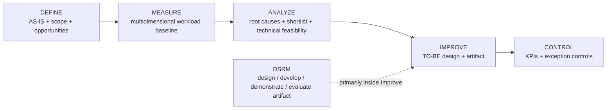

# Phase 1 — Current Methodology and Case-Selection Status

**Status:** Current research-method and case-selection source of truth. Question references were corrected on 7 October 2026 to the five sub-questions in the submitted Plan of Work, as confirmed by Yijie; subsequent scope and timing decisions remain in effect.

**Ownership:** This file owns the research framework, candidate portfolio, selection gates, evaluation logic and current research actions. Detailed workload theory and live Measure-phase collection rules are maintained in their dedicated files rather than duplicated here.

Related sources:

- Project control / DMAIC tollgates: `docs/Project_Charter.md`
- AS-IS process and open process facts: `docs/process/Process_Cleaned_V1.5.md`
- Canonical workload definition: `docs/methodology/Workload_Definition.md`
- Exploratory Measure protocol: `docs/measurement/Measurement_Protocol_v1.3.md`
- Measurement-method justification: `docs/measurement/Measurement_Method_Justification.md`
- Formal company evidence: `docs/company-documentation/Official_Document_Register_2026-08-21.md`
- Working TO-BE hypothesis: `docs/process/TO_BE_Working_Hypothesis_v0.1.md`

---

### Scope update of 14 September 2026

The objective remains reducing the operational buyer's workload while maintaining purchasing quality. The [10 September academic decision](../meetings/Academic_Supervisor_Meeting_Notes_2026-09-10.md) adds Dennis's tactical purchasing work to the research context and keeps logistics outside the thesis. Since [1 October](../meetings/Academic_Supervisor_Meeting_Notes_2026-10-01.md), former EXC work stays in the total time record under OTHER but outside the work considered for AI improvement. Keep actor-specific evidence separate. Apply the [scope and classification addendum](../measurement/Scope_and_Classification_Addendum_2026-09-14.md) and the [purchasing activity framework](../process/Purchasing_Activity_Framework_2026-09-21.md); the [14 September Van Weele crosswalk](../archive/process/Van_Weele_Activity_Mapping_2026-09-14.md) is historical. The submitted Plan of Work provides the main question and five sub-questions; the [current assignment](../proposal/BEP_Assignment_1BEPIEX.md#main-research-question) reproduces that wording and order (see section 3). Measurement and evaluation details remain subject to justification.

# 1. Project objective

The company-level objective is to reduce meaningful workload in operational purchasing by reducing unnecessary administrative effort, repetitive verification, avoidable rework and information-handling burden while preserving or supporting work that depends on purchasing expertise.

The thesis-level objective is to select one high-value purchasing activity or coherent TO-BE process component and design and evaluate a focal artifact containing a **meaningful AI-supported contribution**.

The company expects AI to be part of the focal thesis solution. Conventional process redesign, deterministic rules and digital automation may be supporting components or separate quick-win recommendations. A non-AI focal artifact is an exception: it requires documented Analyze evidence that no candidate passes the responsible-AI, data, quality and evaluation-feasibility gates, followed by explicit company and academic-supervisor approval. The project must not relabel a deterministic rule as AI merely to satisfy the expectation.

Selecting one thesis case does not remove other improvement opportunities from the wider company improvement portfolio.

---

# 2. Research structure

## DMAIC — process-improvement framework

DMAIC structures improvement of the existing purchasing process:

- **Define:** scope, stakeholders, AS-IS process, workload problem and initial opportunity areas.
- **Measure:** establish a defensible multidimensional workload baseline across the operational process.
- **Analyze:** identify root causes, standardizability, constraints and which work should be eliminated, simplified, standardized, automated or supported; then test technical/data feasibility for the shortlisted candidates.
- **Improve:** design evidence-based TO-BE alternatives and develop the selected artifact.
- **Control:** define KPIs, ownership, exception controls and implementation safeguards.

DMAIC fits because the project improves an **existing** process rather than designing a completely new process from scratch.

## DSRM — artifact design and evaluation

If a digital/AI artifact is developed, its design and evaluation follow DSRM:

`problem identification → objectives → design/development → demonstration → evaluation → communication`

DSRM mainly supports DMAIC's Improve stage, while some problem/objective work naturally begins earlier as the focal case is defined.

## Visual relationship

Within this structure:

- `Process_Cleaned_V1.5.md` mainly supports **Define** and the transition into Measure;
- Section 4 below is the authoritative candidate-status portfolio to be tested by Measure/Analyze;
- `../measurement/Measurement_Protocol_v1.3.md` operationalizes the exploratory **Measure** phase;
- `TO_BE_Working_Hypothesis_v0.1.md` is an early **Improve hypothesis**, not yet an Improve conclusion;
- the final digital/AI artifact is selected only after the relevant Measure and Analyze gates are satisfied.

---

## CTA-informed elicitation

Cognitive Task Analysis-informed questioning is used where buyer expertise matters to the selected task, such as interpreting a discrepancy or deciding which source to trust. Maximalisatie and downstream order/hold reasoning remain conditional alternatives, not a separate required study while order and confirmation checking is the provisional focus.

If maximalisatie/order-hold remains relevant to the choice or selected design, elicitation can cover:

- how the buyer searches for additional same-supplier demand;
- what makes consolidation useful enough to proceed;
- after MAX, whether or not demand was added, what makes the resulting order proceed versus be held (including size, urgency, MOQ/minimum-value considerations and current purchasing context);
- what later causes a held requirement to be reconsidered;
- which cues are explicit in data versus experience-based or undocumented.

This is **CTA-informed elicitation**, not automatically a full standalone CTA study.

## Human-AI reliance

Judge-Advisor System / reliance concepts remain conditional. They become relevant only if the final artifact gives advice that a buyer can accept, modify or reject. They are not automatically required for pure administrative automation or discrepancy detection.

---

# 3. Measure design

The [question block](../proposal/BEP_Assignment_1BEPIEX.md#main-research-question) reproduces the submitted [Plan of Work](../proposal/Plan_of_Work_Final_2026-09-22.pdf), section 2: SQ1 concerns the standard workflow and operational–tactical relationship; SQ2 concerns implementation conditions and controls; SQ3 concerns workload contribution in terms of proposed measures; SQ4 concerns candidate comparison and selection; SQ5 evaluates workload reduction while maintaining purchasing quality. Process maps address SQ1. Workload profiling and investigation of contributing factors support SQ3 and inform SQ4. Implementation requirements support SQ2, and the evaluation design supports SQ5. These are five distinct questions; this correction restores their submitted wording and numbering.

The broad workload construct is defined in `Workload_Definition.md` and uses a layered structure:

- **overall/occupational workload:** amount and difficulty of work, grounded primarily in Bowling & Kirkendall (2012);
- **quantitative workload / organizational constraints:** conceptually supported by Spector & Jex (1998);
- **mental workload:** not assessed in the current study; judgement and expertise notes remain qualitative task evidence;
- **expertise dependence:** kept analytically separate from mental workload.

The project therefore does **not** use processing time as a proxy for total or mental workload, and it does not create an unvalidated composite equation combining heterogeneous indicators.

Detailed live timing rules remain in `../measurement/Measurement_Protocol_v1.3.md`, except for its historical exclusive active-time instruction. The [scope addendum](../measurement/Scope_and_Classification_Addendum_2026-09-14.md) applies the logistics and EXC scope rules, governs post-session classification and specifies full intervals for genuinely simultaneous activities. Yijie clarified on 30 September that he applied this timing instruction following the 17 September supervisor meeting. The [21 September purchasing activity framework](../process/Purchasing_Activity_Framework_2026-09-21.md) now defines concrete analytical activities within Van Weele stages, linked to the unchanged task register. The seven live families remain; full activity labels, separate task/stage/activity confidence and assignment reasons are added after observation. Combined and unresolved work remains explicit, preserving earlier measurements without invented timing splits. The exploratory Measure phase records a multidimensional activity-family profile, with post-session detailed Task-ID enrichment where evidence supports it, using where relevant:

- frequency;
- active processing time;
- case/line volume;
- rework occurrence and time;
- interruptions and task switching;
- qualitative difficulty / uncertainty / exception evidence;
- expertise dependence.

The method source and the construct source are deliberately separated. The workload literature defines what the project means by workload; a researcher-developed structured continuous-observation time-and-motion protocol, informed by STAMP and WOMBAT principles and adapted through the local AS-IS process and pilot, records the observable objective component. The exact source-to-field mapping and claim limits are documented in `../measurement/Measurement_Method_Justification.md`.

For comparable recurring execution tasks:

`operational time burden = frequency × representative active processing time`

is a buyer-capacity indicator, not a total workload or mental-workload score.

For fast judgement-heavy activities, occurrence, outcome, cues and reasoning are more informative than artificial second-level timing.

**Role of the exploratory Measurement Protocol.** Measurement Protocol v1.3 characterizes the current procurement process and screens for recurring sources of observable operational effort. It records occurrence, reliable active processing time, case context, interruptions, clarification, exception work and supported decision/expertise cues at activity-family level. These observations justify candidate generation and focal-case selection, but they do not estimate the effect of an AI artifact and do not measure purchasing outcome quality. The protocol therefore contributes indirect baseline evidence to the main research question rather than answering it independently.

**Transition to focal evaluation.** After Analyze selects one focal activity, a separate activity-specific protocol will define eligible cases, the manual comparator, justified workload indicators for the selected component, the final purchasing-quality rubric, critical-error definitions, workload-improvement threshold, acceptable quality margin, sampling design and analysis plan. These elements are frozen before artifact development and formal testing. The main research question is answered from the matched comparison of the manual and AI-assisted workflows; the broad Measure dataset supplies process context and the justification for focal-case selection.

### Current Measure sequencing

1. The 28 August pilot identified that direct live coding against the 31-task register was too granular for reliable one-observer use.
2. Five official Arno sessions are recorded through 23 September, in addition to the 28 August pilot, with 892 minutes of confirmed net observation (see the [observation-time review](../measurement/Observation_Time_Review_2026-09-25.md)). Dennis was observed on 25 September. The observer-reviewed daily CSVs of 30 September (one per session, with a Van Weele stage column) are the current working data; the earlier 21 and 25 September enrichments are historical. The pilot remains separate and the 8 September OBS-16 contamination exclusion remains. Historical summaries below cover only two sessions: 31 August (165 net observed minutes; 103 timed coded-active minutes after source verification of the untimed OBS-04 SEND and OBS-05 EXC tallies) and 1 September (186 net observed minutes; 162 timed coded-active minutes). Their historical totals are **351 net observed minutes** and **265 timed coded-active minutes** under the earlier broader scope. These are different quantities and are not updated four-session or EXC-filtered totals. Current results are calculated from all rows of the observer-reviewed daily CSVs, with former EXC (shown as "OTHER (outside improvement)" since 1 October) and other flagged rows as separate groups rather than dropped; see [Current totals from the reviewed CSVs](../measurement/README.md#totals). The included profiles in the observation files and the consolidated activity dataset are historical.
3. `../measurement/Measurement_Protocol_v1.3.md` is controlled for observations from 2 September onward, with the dated scope and timing amendments in the scope addendum. Its live fields remain comparable with v1.2. The full-interval rule for genuinely simultaneous activities applies following the 17 September instruction; the addendum documents timing comparability. Version 1.3 also updates MAX interpretation, the five-day coverage rule and repository governance.
4. The initial five-day Arno review point has been reached. Use the recorded coverage and retrospective stability/saturation assessment to state what the sample supports and where uncertainty remains. Dennis’s existing 15 and 25 September evidence supports a separate pattern/handoff summary; extend it only for a material unresolved question. Five dates are not 40 net observed hours, and Dennis does not require the same quantity of observations.
5. Analysis proceeds under the supervisor’s 1 October direction, with coverage limits made explicit. The current [analysis notebook](../../Arno_Analysis_2026_10_02.ipynb) records the retrospective coverage assessment; the [kinds-of-work codebook](../archive/kinds_of_work/Kinds_Of_Work_Codebook.md) documented the labels used until 12 October, when the analysis was rebuilt on the original codes and the agreed stages ([stage review](../measurement/Stage_Review_2026-10-12.md)). The obsolete meeting-preparation files were removed on 6 October. The supervisor confirmed on 1 October that analysis starts now; no stability threshold was agreed, and conclusions that depend on Dennis's data stay provisional. The analysis after that meeting is in [Arno_Analysis_2026_10_02.ipynb](../../Arno_Analysis_2026_10_02.ipynb).

**Current feasibility work is targeted to the shortlisted candidates.** The earlier deferral prevented broad Exact/Orbis integration work during exploratory Measure; it is not a reason to postpone the present test-account checks in Analyze. Investigate only the data, reference examples and interfaces needed for the candidate boundary.

---

# 4. Current candidate portfolio

The [AI function comparison](AI_Function_Comparison_2026-10-02.md) of 2 October maps observed tasks to the AI function they would use, the buyer's role, supporting literature and buyer acceptance, following the 1 October action. It informs, but does not replace, the candidate assessment below.

Candidate names are used instead of reusable letter IDs so that a candidate cannot mean different things in different documents. The AS-IS process file may retain local profile labels for navigation, but this methodology file is authoritative for current thesis-candidate status.

## 4.0 Status of the selection, reviewed 9 October 2026

*Note, 12 October 2026:* the figures in this section are the 7 October scenario, defined on the archived kinds-of-work labels. Since 12 October the candidate evidence is defined on the original codes (checking = the CHECK code, 91 minutes, 16.2%); no score changed, two request-intake ranges widened, and the provisional totals are 76.2, 56.8 (article/supplier data), 51.9 (maximalisatie) and 50.8 (request intake); six combined one-point changes would put article/supplier data ahead. The current figures are in the [selection notebook](../../Focal_Case_Selection_2026-10-07.ipynb), sections 4 and 5; the method below is unchanged.

Yijie's 7 October provisional selection applies the two-stage rule of section 5.3 in the [selection notebook](../../Focal_Case_Selection_2026-10-07.ipynb), with Yijie's individual swing weights. The [8 October meeting](../meetings/Academic_Supervisor_Meeting_Notes_2026-10-08.md#selecting-the-improvement-task) left the criteria, weights and focal choice provisional and requested definitions and rationale. The numeric scores and totals below preserve the 7 October scenario; they have not been reviewed against the broader boundary. The notebook contains its own gate verdicts, weights and scores, with the evidence for each. The descriptions in sections 4.1–4.4 below are the candidate profiles from before the selection.

| Candidate | Stage A result | Stage B total (of 100) | Role after the selection |
|---|---|---:|---|
| Order and confirmation checking (called purchase-price control until 7 October) | Provisional pass (gate 1 passed on 7 October) | 76.2 | **Provisional focal case**, original scenario uses broad checks (98 minutes), not a validated eligible-task total; boundary widened on 7 October to price, delivery date, quantity and missing or extra lines |
| Article / supplier data in Exact | Provisional pass | 56.8 | First fallback if order and confirmation checking fails gates 2–3 |
| Order timing / maximalisatie | Redesign: only a list of same-supplier open POs and demand | 51.9 | Further opportunity in narrowed form |
| Request intake & validation | Redesign: only retrieving old POs and drawings | 50.8 | Further opportunity in narrowed form |
| PO supplier communication | Reject, gate 6 (ordinary automation is enough) | – | Quick-win recommendation |
| Standard / review / manual | Reject as a stand-alone candidate, gate 5 | – | Design frame of the focal case |

Under the retained 7 October score scenario, order and confirmation checking stays first in every single-change sensitivity check; six combined one-point changes within the recorded ranges would put article data ahead. Final selection still needs review of the boundary, criteria, scores and weights with Zhongxin, relevant test-account/reference checks (starting with PC1–PC4, gates 2–3), Arno's acceptance of the specific support (gate 4) and Johan's confirmation of the business value. Dennis's [15 September explanation](../meetings/Internship_notes_2026-09-15.md#prices-and-updates) that outdated purchase prices led Sales to sell items at a loss, repeated in Yijie's report at the 8 October meeting, supports the retained business-value score of 3. The original score-5 anchor requires company-supervisor confirmation with examples or figures. Financial impact and achievable benefit remain unquantified. The [9 October boundary review](../archive/kinds_of_work/Candidate_Evidence_Matrix_2026-10-07.md#review-of-the-broadened-order-checking-scores) (archived) identifies 11 broad K18 minutes whose fit with the narrower quotation/confirmation intervention is unresolved; no scores or recorded minutes are changed. Article / supplier data was added as a candidate during Analyze: creating and maintaining article and supplier records in Exact, including one case that continued over two days for missing data ([evidence matrix](../archive/kinds_of_work/Candidate_Evidence_Matrix_2026-10-07.md), archived).

## 4.1 Active primary-case candidates

| Candidate | Current reason | Main evidence gates | Possible artifact direction |
|---|---|---|---|
| **Order timing / maximalisatie / supplier-order consolidation** | Repeated judgement-intensive activity involving stock, future demand, open POs, lead time, urgency and maximalisatie. Useful same-supplier demand can be combined; after MAX, the resulting order is assessed and may be held or ordered whether or not demand was added. | Measure-phase workload contribution and frequency; CTA decision rules; after Measure: Exact/Orbis data feasibility and defensible benchmark | decision / information / optimization support |
| **Order and confirmation checking** (called purchase-price control until 7 October) | Repeated manual verification with measurable discrepancy outcomes, both pre-PO and post-confirmation. *Analyze, 6 October:* order checks (K04, K17, K18) take 98 of 560 minutes without former EXC in Arno's five sessions, on all five days. Of these, 28 minutes are in 6 records whose note names a price check or price difference (on 8 and 18 September, 25 minutes on 18 September), 56 are in checks whose subject is not recorded and 14 concern other subjects, including one price check that could not be completed. *7 October:* Yijie, who observed the sessions, clarified that the 56 minutes were regular price and delivery-date checks, so 94 of the 98 minutes are checks of price and/or delivery date; the candidate was widened and renamed accordingly. These classify recorded intervals; the split between price and delivery date is not measured. The case also rests on the reported causes: outdated prices in Exact, changing supplier prices and no automatic confirmation-to-PO comparison ([session guide, what Yijie reported on 2 October](../measurement/Arno_Follow_Up_Session_Guide_2026-10-02.md#what-yijie-reported-on-2-october)). | What a check normally compares and how often confirmations are checked and differ (Arno session; this describes the task, it does not re-allocate recorded minutes); line complexity, deviation rate and verification demand; supplier/Exact data feasibility, starting with the Exact test account; agree the widened boundary and its workload evidence with the academic supervisor; the 28 price-named minutes remain the lower bound | automated retrieval/comparison, stale-price/deviation support |
| **Standard / review / manual process redesign** | Promising process-level hypothesis if a meaningful share of cases is repeatable and safely classifiable | standard-case share, addressable workload, exception boundary, quality/safety risk; after Measure: system/data feasibility and evaluation feasibility | exception-based workflow with rules/automation/AI where justified |

The detailed AUTO / REVIEW / MANUAL future-state hypothesis is maintained in `TO_BE_Working_Hypothesis_v0.1.md` and remains provisional.

## 4.2 Active but evidence-insufficient candidates

| Candidate | Current position | Main evidence needed |
|---|---|---|
| **Request intake & validation** | Real information-quality/tacit-knowledge burden observed | frequency, investigation time, error types, business impact |
| **Finance-returned EXC aftercare** | Excluded from the thesis candidate set by the EXC scope decisions of 10 September and 1 October | Its time stays in the total record under OTHER, outside the improvement scope; it cannot determine the focal case |

## 4.3 Supporting improvement opportunities, not current primary thesis candidates

| Topic | Current position |
|---|---|
| **Exact Advies / Toewijzen** | Important system/process-control topic; `Toewijzen` is primarily an assignment/control action rather than a stand-alone optimization problem |
| **PO supplier communication** | Clear repetitive quick win / semi-automation opportunity; likely too narrow as the primary thesis case unless volume shows substantial total burden |

## 4.4 Ruled out / deprioritized

### Logistics and EXC

Logistics and former EXC aftercare cannot become the focal case. Since 1 October their time stays in the total time record under OTHER, outside the work considered for AI improvement, so its share stays visible. Retain historical raw evidence.

### Supplier selection in the expanded purchasing context

Earlier evidence indicated that suppliers are normally predetermined for Arno. Dennis's inclusion means supplier-selection tasks can now be investigated as purchasing context. This does not establish a recurring operational-buyer workload problem or a selected supplier-selection artifact. Any candidate must demonstrate a connection to the primary workload objective and pass the same evidence and feasibility gates.

---

# 5. Decision gates before final case selection

## 5.1 Measure-phase evidence gates

1. **Workload baseline:** which activities contribute meaningful quantitative and/or qualitative workload rather than merely appearing interesting in isolated observations?
2. **Frequency / case mix:** how often do relevant tasks and case types occur across the observed working periods?
3. **Active processing time / volume:** for timed activities, what are the representative active-time distributions and how do they relate to line/case volume?
4. **Rework and organizational constraints:** where do repeated work, interruptions, missing information or hand-off problems materially affect the buyer?
5. **Expertise dependence:** which activities rely on tacit cues or experience that cannot yet be reproduced from explicit process rules/data?
6. **Standard-case boundary:** what share of the observed work appears routine/standard versus review/manual/exceptional, without yet assuming automation feasibility?

## 5.2 Analyze-phase feasibility gates — after Measure

7. **Exact/Orbis data availability:** for the shortlisted candidate(s), which production fields, histories and interfaces are reliably accessible?
8. **Exact `Advies` logic:** investigate only to the degree required by the shortlisted case.
9. **Technical feasibility:** usable supplier-price sources, Exact/Orbis interfaces and integration constraints for the shortlisted candidate(s).
10. **Benchmark / ground truth:** can a defensible reference be constructed before AI/artifact evaluation?
11. **Exception safety / quality risk:** can high-risk or unusual cases be detected and controlled appropriately?
12. **Evaluation feasibility:** sufficient repeated cases, measurable workload and quality outcomes, and participant/domain-expert access.
13. **University-supervisor alignment:** confirm the final case and evaluation design before freezing artifact scope.

## 5.3 Formal two-stage selection rule

The focal case is selected in two stages. A weighted score may not compensate for a failed veto gate.

### Stage A — veto gates (Pass / Redesign / Reject)

1. Required data and tooling are permitted for the intended research use.
2. Accessible data are sufficiently representative for a prototype and test.
3. A reproducible ground truth/reference standard and manual baseline can be created.
4. Critical errors are detectable/reversible and residual risk can be controlled through human review, an audit trail and fallback.
5. Prototype development and evaluation fit the BEP's time, access and participant constraints.
6. The task has a non-trivial AI fit: unstructured, probabilistic or pattern-based support creates value beyond a simpler deterministic rule.

If no candidate passes all gates, no candidate enters the weighted comparison and no unsuitable AI case is forced. First test a bounded redesign, such as narrowing the task, reducing AI autonomy, adding human review or improving the usable data. If no responsible and evaluable AI-supported case remains, report the failed gates as a feasibility finding and seek an explicit scope decision: the academic supervisor determines academic acceptability and the company supervisor confirms operational feasibility/permission. A conventional digital solution may remain a benchmark or recommendation, but it does not silently replace the intended AI-supported focal artifact.

### Stage B — evidence-scored comparison

**Review draft, 9 October 2026, responding to the 8 October meeting.** The seven existing criteria remain. Their definitions and rationale are set out below for Zhongxin's review. They do not estimate benefits after implementation: On 8 October Zhongxin cautioned against using achieved time savings to select the solution that will produce them. These are project-developed selection rules, informed by the research objective, the workload definition, Task–Technology Fit and the MCDA sources already registered (Goodhue & Thompson, 1995; Belton & Stewart, 2002; DCLG, 2009). The literature does not prescribe these seven criteria or the numerical cut-offs. Verify the cited sources before thesis use.

The student constructs the matrix, documents the evidence, calculates scores and makes the final reasoned recommendation. The student and academic supervisor agree the criteria definitions, scoring anchors, plausible scoring ranges and weights. The company supervisor validates operational evidence, such as workload, business relevance, data/system access, implementation constraints and risk controls, but does not own the academic weights or final research ranking. Buyers' explanations, such as Dennis's on outdated prices, are evidence the company supervisor can confirm. The [8 October notes](../meetings/Academic_Supervisor_Meeting_Notes_2026-10-08.md#selecting-the-improvement-task) record agreement to review the weights, not agreement on a final weighting method or set.

#### Criterion definitions and rationale

| Criterion | Definition and purpose | Evidence to use | Boundary that prevents double counting |
|---|---|---|---|
| Observed workload contribution | The current human effort associated with the bounded activity. It identifies where improvement could address Arno's workload (SQ3 and SQ4). Recorded time is one indicator of amount of work; difficulty remains qualitative. | Reviewed durations, denominator and coverage, with specific rework, clarification or judgement examples. Use 560 in-scope recorded minutes for the current scenario, not net observed clock time. | Count current burden, not forecast or achieved savings. Do not add overlapping candidate minutes. Keep business consequences here out of the score. |
| Business value beyond counted workload | A consequence for purchasing or the company beyond the buyer time already counted, such as price errors affecting sales margins. It implements SQ4's business-relevance requirement. | Dated buyer explanations and traceable examples or records, with the causal link to the bounded task stated. Dennis's outdated-price explanation is usable qualitative evidence. | Do not score buyer minutes or their monetary conversion again. A discrepancy amount is not automatically a loss or recoverable saving. Price-data updating and Sales pricing benefits require an actual handoff from the proposed check. |
| AI–task fit | The match between the task's information problem and a useful AI function beyond deterministic rules. It tests whether AI has a meaningful role in the intended artifact. | Actual document examples, extraction/matching ambiguity, a simpler-rule comparison, and relevant verified literature. Current research leads remain untested locally. | Score the need and suitability of AI, not ease of implementation, general interest in AI or buyer acceptance. Preserve exact arithmetic and field comparisons as rules where appropriate. |
| Data readiness above the gate minimum | The usable quality and accessibility of the input corpus once permission and minimum representativeness are established. It identifies cleaning, linkage and annotation work. | A dated inventory of paired inputs, formats, period, linkage, completeness, provenance and export/cleaning effort. | Score input preparation, not evaluation scheduling or development effort. A missing defensible input set reopens gate 2 instead of merely lowering a score. Reference provenance can inform this criterion, but reference validity is a gate. |
| Repetition / process standardisation | Recurrence across the sampled work and consistency of input/output requirements and exception boundaries. It asks whether support can be reused across comparable cases. | Observed days/case-days plus examples of stable fields, document variation and exceptions; a buyer account of frequency when available. | Frequency already contributes to observed time. Use recurrence as coverage context and stability as the distinct judgement, without multiplying minutes by frequency again or scoring a second time-saving benefit. |
| Prototype / technical feasibility | The engineering effort and dependencies of a credible bounded prototype within available BEP resources. | Tested exports, available tools, integration needs, access dependencies and a bounded implementation route. | Score build effort above gate 5, not data quality or the number of evaluation cases. No buildable route is an unresolved/failed gate, not a score of 1. |
| Evaluation feasibility | The practical ability to compare the manual and supported workflows using valid references, comparable cases and buyer time. It supports answering SQ5. | A candidate reference/adjudication process, case mix, manual comparator, rubric, held-out cases and participant availability. | Score the test arrangement above gate 3, not prototype ease or input cleaning again. Inventing test workloads does not supply correct answers, and observed time is not proof of improved performance. |

#### Anchored scoring scale

All candidates use the same 1/3/5 anchors, as proposed to Zhongxin in the [scoring brief](https://claude.ai/artifact/P2bsL8ZfyDhdJZanQAdk6n) and used for the 7 October scores. Scores 2 and 4 indicate an evidenced intermediate position, with a written reason. Missing evidence is marked unresolved. These cut-offs are transparent project judgements, not validated natural thresholds.

| Criterion | 1 | 3 | 5 |
|---|---|---|---|
| Observed workload contribution | Under 5% of in-scope minutes, little recorded burden | 5–15%, or less time with clear recorded burden | Over 15%, with recorded burden on several days |
| Business value beyond counted workload | No effect named beyond buyer time | One effect named with an example | Effect confirmed by the company supervisor with examples or figures |
| AI–task fit | Just passes gate 6: AI adds little beyond rules | AI needed for one part, the rest is rules | The core of the task needs reading unstructured documents or judging patterns, with a precedent in the literature |
| Data readiness above the gate minimum | Few hand-collected examples, no recorded correct outcome | Enough past cases with moderate cleaning or labelling | Representative past cases can be exported, with a traceable correct outcome |
| Repetition / process standardisation | Seen on fewer than 3 of 5 days, or inputs differ every time | Every day, but inputs vary or exceptions are frequent | Many cases every day, stable inputs and outputs, clear exception boundary |
| Prototype / technical feasibility | Needs Exact integration or access not yet granted | Can be built on exports or copies, with manual steps | Can be built on available data and tools, with no integration |
| Evaluation feasibility | No reference answer, or no comparable cases | Some cases and a rubric; limited buyer time | Enough repeated cases with a reference answer, and buyer time, or test workloads built from past orders and handled by the buyer in both conditions |

**Proposed clarifications for Zhongxin's review, 9 October (not adopted, and not used in the scores):**

- Business value, score 5: accept a buyer's or process owner's account with corroborating examples or records, instead of the company supervisor's confirmation.
- Data readiness, prototype and evaluation, score 1: reword so that a 1 still means the gate is passed. A failed gate cannot be turned into a score of 1.

Changing anchors after seeing the scores risks biasing the comparison. Agree and document any proposed change with Zhongxin before adopting it. If adopted, revisit affected scores and swing weights and rerun the comparison. For workload, do not invent a minute split or upgrade a score from a general difficulty claim.

#### Weights and review status

| Criterion | Yijie's individual swing weight, provisional (7 October) |
|---|---:|
| Observed workload contribution | 27.0% |
| Business value beyond counted workload | 10.8% |
| AI–task fit | 13.5% |
| Data readiness above the gate minimum | 16.2% |
| Repetition / process standardisation | 8.1% |
| Prototype / technical feasibility | 10.8% |
| Evaluation feasibility | 13.5% |

Yijie's swings (100, 40, 50, 60, 30, 40, 50) were [recorded](../analyze/Swing_Weights_Yijie_2026-10-07.md) on 7 October before candidate scoring. Each swing represents the value of moving from anchor 1 to 5; dividing by the sum gives the weight. They remain Yijie's individual assessment, made with knowledge of the workload figures. The earlier 25/15/15/15/10/10/10 table was only an example.

The existing proposal is to obtain Zhongxin's independent swings before showing the ranking, average the two sets and discuss differences above 10 raw swing points. The 8 October meeting confirms a weights review, not adoption of this exact procedure. Agree the procedure and final set with Zhongxin. If independent elicitation is used, preserve its conditions; do not claim independence if she has already seen the scores. Changed anchors require revisiting the swings. No supervisor weights or agreement have been supplied in this update.

Use the total `Σ(weight × score/5)`, or multiply by 100 for the notebook's displayed points. With all scores at 1 the displayed total is 20; with all at 5 it is 100. It is a preference score, not a percentage of workload reduction or an implementation-success probability.

**Overlap and uncertainty check before final scoring.** For every retained score, identify its specific effect and evidence. One document may inform several distinct facts, but the same benefit must not raise several criteria. In particular, separate workload from repetition, input readiness from build effort and test feasibility, and price-checking benefits from unimplemented price-data updates. Retain score ranges and test combinations of assumptions. The remaining overlap is a limitation of the additive comparison; the safeguards do not prove statistical independence or eliminate all preference dependence.

Run a proportionate sensitivity check using (a) the agreed weights, (b) equal weights, (c) each weight changed by ±20% with renormalization and (d) disputed scores changed by ±1. If the winner changes, report the ranking as unstable and collect more evidence or retain a shortlist rather than hiding the dependence on assumptions. The selection notebook adds the individual weight sets, the price-only boundary, the fewest combined one-point changes that reverse the ranking, a stress test and random draws as an illustration.

Unresolved facts about the **current process itself** remain in `Process_Cleaned_V1.5.md` rather than being duplicated here.

---

# 6. Evaluation logic by problem type

The selected focal activity determines the final activity-specific metric, but the **success logic is predeclared now**.

## 6.1 Workload endpoint and quality guardrail

The artifact is successful only when **both** conditions hold:

1. the primary workload endpoint improves by at least the predeclared meaningful threshold; and
2. the quality guardrail passes.

**Measurement rule.** Whatever endpoint is chosen, it measures the buyer's work, not the artifact's. If time is the endpoint, it is the buyer's active processing time per eligible case or line, measured in both conditions on the same or matched cases: once as the work is done now, and once with the artifact, including the review, correction, data entry and handoff the artifact leaves to the buyer and any work it creates for him (checking a flag that proves false, uploading a document, correcting an extraction). The artifact's own run time is not the endpoint and is logged under the reliability control. Processing it performs unattended is outside the buyer's time; time in which the buyer can only wait for it is passive time, recorded with the same rule in both conditions and reported separately, as a condition that interferes with the work, which the project classes with the organizational constraints of the [workload definition](Workload_Definition.md#3-quantitative-workload-and-organizational-constraints). Work the artifact moves to another employee is timed and reported next to the buyer's time, never subtracted from it. An artifact can therefore take longer than the buyer and still reduce his work, or be faster and not reduce it; both are findings. Difficulty is not inferred from time: where qualitative workload is reported, it has its own indicator, as qualitative evidence and not a score. The candidate-specific measurement model for the provisional focal case is in the [design draft, section 8](../process/Order_Confirmation_Checking_Design_Draft_2026-10-09.md#8-draft-evaluation-protocol-to-complete-after-selection); it is frozen, with the endpoint, once the selection is final. If no buyer takes part in the assisted condition (the planning assumption since 14 October), the workload endpoint cannot be measured on the buyer and is estimated instead: the manual comparator is the buyer's observed active time per check, the aid's output is scored against the reference answers, and the review time is that of a substitute reviewer under the same rule; the success rule is then reported in its estimated form, as a quality guardrail passed on the tested cases plus an estimated reduction with stated assumptions, never as a measured reduction of the buyer's workload.

The primary endpoint will be justified after selecting the component by linking it to the workload dimension the improvement is intended to address. Active processing time per eligible case or line remains a possible indicator of time requirements, alongside evidence about frequency, repeated work and difficulty. No endpoint is fixed merely because the exploratory baseline records it. If time is selected, include reading, searching, data entry, human review, correction and the required handoff; report passive waiting and unrelated interruptions separately. Define case comparability and include eligible cases where work is prevented. Limit conclusions to the workload dimensions supported by the evaluation.

Supporting indicators may describe manual actions, system switches, rework, throughput and qualitative difficulty evidence where relevant. Their definitions, evidence sources and role in interpretation must be specified. They are not combined into an unvalidated total-workload score, and the current study does not assess mental workload.

Quality is measured on the **final human-approved outcome**, not only the AI output. After focal-case selection, define a case-specific rubric, a trusted reference/adjudicator and critical versus minor errors. The default guardrail is zero observed critical errors plus final-decision correctness no more than a pre-agreed margin `δ` below the matched manual baseline. `δ = 0` for critical errors; any non-zero margin for minor errors requires explicit process-owner acceptance. With a small BEP sample, report that the guardrail passed in the observed cases rather than claiming statistical non-inferiority.

After the manual baseline and focal case are known, the company/process owner defines the smallest worthwhile workload improvement `Δ` and acceptable minor-error margin `δ`; the academic supervisor validates the research rule. Freeze eligible cases, comparator, rubric, `Δ`, `δ` and analysis before prototype development/formal testing. Keep development examples separate from held-out evaluation cases where feasible.

BEP-ready rule: `For eligible [case type], the AI-supported workflow meets the predefined improvement threshold on [justified workload endpoint] versus [comparator], while the final purchasing outcome fulfils [activity-specific quality requirements]. State which workload dimension the endpoint supports and report effects on Dennis separately where his work changes.` Estimated form, when no buyer takes part in the assisted condition: `For eligible [case type], the aid's output fulfils [activity-specific quality requirements] on the tested cases, and the buyer's active time for the steps the aid takes over, [observed comparator], less the review time of [substitute reviewer], gives an estimated reduction of [value], under [assumptions]; the reduction is potential, not measured on the buyer.`

## Optimization / decision-support case

Possible measures:

- decision quality against a defensible benchmark;
- constraint violations;
- consistency;
- active processing time;
- relevant workload measures from the selected activity;
- human override/reasoning where relevant.

## Verification / detection case

Possible measures:

- accuracy;
- precision/recall where appropriate;
- false positives/negatives;
- deviations detected;
- processing time;
- relevant workload change;
- consistency.

## Exception-based automation / process-redesign case

Possible measures:

- standard-case classification accuracy;
- exception-detection recall;
- exception escape rate;
- PO/output accuracy against trusted reference cases;
- percentage eligible for straight-through processing;
- correction/review rate;
- active buyer effort avoided;
- effect on remaining attention/judgement demand;
- false-positive review burden.

Processing-time reduction alone should not automatically be reported as mental-workload reduction. Likewise, the project should distinguish **potential/estimated workload reduction** from **realized operational reduction** if the artifact is evaluated only on standardized/historical cases rather than deployed live.

---

# 7. Current remaining actions, reviewed 9 October 2026

1. **Close the decision-relevant evidence gaps.** Use the existing [Arno follow-up guide](../measurement/Arno_Follow_Up_Session_Guide_2026-10-02.md) to confirm the reported causes, what pre-order and confirmation checks compare, their approximate frequency and buyer acceptance of the proposed support. Record answers as dated statements; do not reallocate historical minutes from recollection. The [9 October source-to-label desk review](../archive/kinds_of_work/Targeted_Label_Review_2026-10-09.csv) and [codebook](../archive/kinds_of_work/Kinds_Of_Work_Codebook.md) are archived since 12 October. The desk review retains existing labels; it is not new observer confirmation or an independent reliability test. The retained 45-record recoding sheet and κ are optional, not completion gates.
2. **Resolve feasibility and confirm the focal boundary.** Complete the targeted test-account checks and use company input to validate operational evidence, permissions and controls. Yijie’s provisional 7 October comparison puts order and confirmation checking first; it remains first in single-change sensitivity checks, but combinations can reverse the ranking and missing confirmations or approved prices reopen gates 2–3. Review the criteria, anchors, score evidence and weighting procedure with Zhongxin, then record the agreed weights and final selection or bounded redesign in the [selection notebook](../../Focal_Case_Selection_2026-10-07.ipynb). Since 12 October the checking evidence is the CHECK code (21 records, 91 minutes, 16.2% of the in-scope minutes); report the observer's 7 October clarification as a clarification, and keep visible that the notes name a price or delivery date for 33 of the 91 minutes, an unspecified mismatch for 20 and nothing specific for 38.
3. **Synthesize Dennis’s existing contribution.** Summarize the relevant tasks and demonstrated connections to Arno from the 15 September notes and 25 September observation, keeping actors separate. Ask targeted follow-up questions only where his role, information, acceptance or affected work matters to the selected case. Additional observation is conditional; his unconfirmed exposure does not support per-hour workload comparisons.
4. **Freeze the focal evaluation before development and formal testing.** Justify eligible cases, the manual comparator, workload endpoint and its claim limits, final-human-outcome quality rubric/reference, critical errors, meaningful improvement Δ, acceptable minor-error margin δ, sampling and analysis. Confirm the case and design with the academic supervisor and the operational thresholds with the process owner; separate development from evaluation cases where feasible.
5. **Develop and evaluate the bounded solution, then write Control recommendations.** Select only the technical components needed for the chosen workflow. Compare the manual and AI-assisted work under the frozen protocol, including review/correction effort. Report quality and workload separately, observed limitations, ownership, monitoring and fallback. The general TO-BE and toolkit remain design options, not a requirement to build end-to-end automation.

Maintain the existing raw-data and scope rules throughout: use reviewed daily CSVs, keep the pilot separate, retain former EXC/other flagged work visibly outside the improvement comparison, and preserve missing and combined intervals without invented splits. No broad new observation round, full reclassification exercise or additional study is implied. Read and verify the sources actually needed for the analysis/design claims using the [literature reading order](../../literature/README.md#reading-order-for-the-current-work), and draft the corresponding thesis sections alongside this work.

# References added for selection and evaluation design

Belton, V., & Stewart, T. J. (2002). *Multiple Criteria Decision Analysis: An Integrated Approach*. Kluwer Academic Publishers. https://doi.org/10.1007/978-1-4615-1495-4

Department for Communities and Local Government. (2009). *Multi-Criteria Analysis: A Manual*. https://www.gov.uk/government/publications/multi-criteria-analysis-manual-for-making-government-policy

Goodhue, D. L., & Thompson, R. L. (1995). Task-technology fit and individual performance. *MIS Quarterly, 19*(2), 213–236. https://doi.org/10.2307/249689

Triantaphyllou, E., & Sánchez, A. (1997). A sensitivity analysis approach for some deterministic multi-criteria decision-making methods. *Decision Sciences, 28*(1), 151–194. https://doi.org/10.1111/j.1540-5915.1997.tb01306.x

