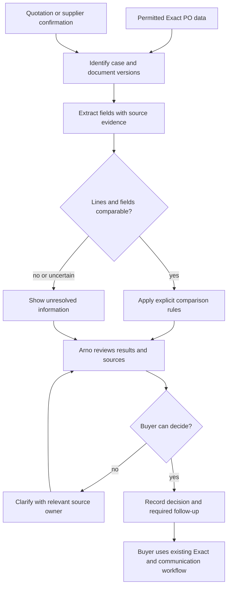

# Order and confirmation checking: design draft

**Status, 9 October 2026:** conditional design preparation for **order and confirmation checking**, the provisional leading candidate. The focal task, data readiness, accepted assistance and evaluation protocol remain open. This document does not establish a prototype or new company-system access.

**Relation to the [TO-BE working hypothesis](TO_BE_Working_Hypothesis_v0.1.md) of 2 September:** that file keeps the earlier end-to-end AUTO / REVIEW / MANUAL idea; this draft replaces it, for the focal case, with bounded checking support. In the [8 October academic meeting](../meetings/Academic_Supervisor_Meeting_Notes_2026-10-08.md#buyer-acceptance-and-the-business-value-example), Yijie reported that Arno and Dennis opposed automatic PO creation and sending because they would lose control and awareness of orders. This does not establish rejection or acceptance of a tool that reads documents and flags differences. Standard / review / manual remains a possible way to organize checking results, not permission for automatic ordering.

**Ownership:** this file holds the candidate design, the existing Dennis role/handoff synthesis, and a draft evaluation specification. The [methodology](../methodology/Phase_1_Current_Methodology.md) owns the gates, selection and evaluation rules. The [AS-IS master](Process_Cleaned_V1.5.md) remains the current-process reference.

## 1. Focal-task problem and boundary

The candidate addresses Arno's effort in retrieving purchasing evidence, comparing order information and investigating differences. The proposed output is a source-linked comparison for his decision. Maintaining correct purchasing information is the quality objective; shorter handling time alone is insufficient.

The [AS-IS sections 4.7 and 4.10](Process_Cleaned_V1.5.md#47-pre-po-price-control) identify two control points. The final scope may cover one or both, depending on accessible evidence and evaluation feasibility. Keep their cases, reference sources and results separate.

| Control point | Candidate inputs, subject to access | Proposed output | Buyer decision retained |
|---|---|---|---|
| Before PO release | Current PO/Exact lines plus applicable quotation, supplier price source or agreed terms | Field comparison and missing, conflicting or unclear information, with source references | Which source applies, whether a difference is acceptable, whether to amend or seek approval, and whether to send |
| After supplier confirmation | Issued PO version, corresponding supplier confirmation and applicable agreed terms where needed | Matched/unmatched lines, field differences and unresolved ambiguities, with source references | Whether the confirmation is acceptable, what to clarify or correct, and whether to complete the existing confirmation workflow |

The broadened candidate concerns prices, delivery dates, quantities and missing/extra lines. It does not establish that every field is available or that historical CHECK minutes can be divided among these fields. The notebooks own the measured boundary (analysis notebook, parts 5 and 8: the CHECK code is 21 records and 91 minutes, 37 in Ordering and 54 in Monitoring). Observed checking time is not all avoidable time.

**Outside this draft:** supplier selection/negotiation by the tool, technical substitution decisions, autonomous PO creation/sending, automatic production Exact changes, logistics and former EXC aftercare. A draft supplier message or proposed master-data update is a possible later extension only if accepted and necessary. Neither is part of the minimum checking output.

## 2. Dennis's existing role and relevant handoffs

This synthesis uses the qualitative [15 September notes](../meetings/Internship_notes_2026-09-15.md), timed [25 September session](../measurement/Measure_Observation_2026-09-25.md) and dated [2 October reported explanations](../measurement/Arno_Follow_Up_Session_Guide_2026-10-02.md#what-yijie-reported-on-2-october). It summarises the existing evidence; the targeted gaps are listed below. Dennis said that he handles more complex/project work and Arno more Service requests, with no strict rule separating their requests.

| Dennis's evidenced work | Recorded action/outcome | Connection to Arno or the candidate | Evidence limit or open point |
|---|---|---|---|
| Develop technical requirements and identify suppliers | Research project needs, list required items and search suppliers; technical questions usually reach Dennis | Technical identity or substitution questions may need Dennis rather than a guessed line match | [15 September role explanation](../meetings/Internship_notes_2026-09-15.md#denniss-explanation-of-the-purchasing-roles). Supports a proposed escalation route, not a confirmed service agreement or measured handoff frequency |
| Prepare supplier price arrangements | Drager active-article data exported to Excel for a fixed-price agreement; an expired discount was discussed | Agreed terms and validity may supply the reference for judging a price difference | [15 September section 5](../meetings/Internship_notes_2026-09-15.md#5-drager-bv-pricing-supplier-contact-and-order-information). Preparation does not prove a concluded agreement or accessible reference dataset |
| Maintain articles and suppliers | Article creation and inactive-item questions; Yijie reported that both buyers create articles and Dennis creates most suppliers | Missing identities, inactive items or stale data can block comparison and require an owner to resolve them | [15 September sections 2, 8 and 9](../meetings/Internship_notes_2026-09-15.md#2-creating-an-article-consisting-of-three-components); [2 October account](../measurement/Arno_Follow_Up_Session_Guide_2026-10-02.md#what-yijie-reported-on-2-october). Not all article upkeep belongs to Dennis |
| Check/update a price while resolving supply | OBS-13 combines item activation, price checking/updating and a call to an alternative supplier, which had no stock | A price/data issue can need supplier knowledge and availability checks beyond numeric comparison | [25 September OBS-13](../measurement/Measure_Observation_2026-09-25.md#afternoon-case-notes). The four-minute combined interval is not isolated price-check time |
| Check offer validity | Dennis asked Gimi whether an earlier offer remained valid and how purchasing would work | A readable historical price may no longer apply | [25 September OBS-12](../measurement/Measure_Observation_2026-09-25.md#afternoon-case-notes). Enquiry recorded; no agreement, award or completed purchase established |
| Resolve order information with colleagues | Arno asked Dennis about the hybrid chamber delay; Dennis left an unresolved MWC quantity to Johan, who had more current information | A checking tool should preserve an unresolved status and identify the missing information | [25 September OBS-03](../measurement/Measure_Observation_2026-09-25.md#morning-case-notes) and [OBS-14 / MWC](../measurement/Measure_Observation_2026-09-25.md#afternoon-case-notes). Neither quantity resolution nor dispatch is established |
| Maintain information used downstream | Dennis reported Sales selling items at a loss because sales prices used outdated purchase prices; Yijie later reported lack of time for updates | Qualitative business relevance exists beyond Arno's time; benefits depend on the later update process | [15 September pricing explanation](../meetings/Internship_notes_2026-09-15.md#prices-and-updates) and [2 October account](../measurement/Arno_Follow_Up_Session_Guide_2026-10-02.md#what-yijie-reported-on-2-october). Dennis's existing account supports the retained business-value score of 3. Financial impact and achievable benefit remain unquantified. Johan's confirmation of the business value is still a selection condition |

The [25 September coverage note](../measurement/Measure_Observation_2026-09-25.md#measurement-quality-and-coverage-notes) records 162 interval minutes but leaves net observation exposure unconfirmed. Keep Dennis separate from Arno's workload totals and avoid per-hour comparisons. Returns, ring repair and other aftercare illustrate his wider role but remain outside improvement scope.

**Targeted Dennis input, only where consequential:** who establishes applicable prices/terms; who resolves uncertain item identity or validity; and who would perform added review or master-data follow-up. His reported role change and unconfirmed return in the [8 October notes](../meetings/Academic_Supervisor_Meeting_Notes_2026-10-08.md#buyer-availability-and-immediate-priorities) leave current responsibility and availability open. Another general observation round is not implied.

## 3. Draft functional requirements

These proposed acceptance conditions are a first draft of the requirements. They need review after the focal boundary is agreed and do not report implemented functionality.

| ID | Proposed requirement | Demonstration needed |
|---|---|---|
| F1 | Identify the control point, PO version and supplier document | Buyer can inspect source references; absent/ambiguous links prevent a complete comparison |
| F2 | Extract agreed fields while retaining original values and page/line/text evidence | Every displayed value is traceable and correctable; missing/unreadable information stays explicit |
| F3 | Match lines without forcing uncertain or duplicate matches | Missing, extra, split, duplicate or ambiguous lines remain visible for buyer resolution |
| F4 | Apply explicit comparison rules | Differences are reproducible; unknown units, currency, price basis or terms block unsupported numeric conclusions |
| F5 | Display matched results, differences and incomplete coverage together | “No detected difference” is distinct from “could not compare”; checked fields and lines are visible |
| F6 | Record buyer review and disposition | Acceptance, correction, clarification or unresolved outcome is recorded with evidence. The tool does not approve a purchase |
| F7 | Preserve the buyer-controlled handoff | Buyer performs approved Exact updates, authorization requests and supplier communication through the existing process. The minimum prototype supplies comparison output only |

## 4. Proposed checking workflow

A permitted file export may be sufficient; production integration is not a prerequisite. “Test data” does not imply a verified Azure service, Exact API or document-processing route.

A standard result means no difference was detected in fields successfully checked. It does not authorize release, amendment or automatic confirmation. Manual handling remains available when documents, identities or reference terms cannot be established.

## 5. Draft AI-versus-rules decision

| Component | Proposed mechanism | Reason and condition |
|---|---|---|
| Read structured Exact/export fields | Direct structured import | Preserve known identifiers and values; AI adds no justified value to copying them |
| Interpret varying supplier layouts or descriptions | Compare AI/document extraction with a simpler parser/template approach | Actual documents must establish the variability and whether a simpler method suffices |
| Match differently described/identified lines | Exact identifiers/rules first; AI suggestions for remaining ambiguity | Suggestions need source evidence and buyer verification. Confidence scores are not calibrated probabilities unless tested |
| Compare numbers and explicit dates | Deterministic rules and documented normalization | Arithmetic, units, currency, discounts and date semantics should be reproducible |
| Decide whether a discrepancy is acceptable | Arno, involving the relevant source owner where needed | A difference from Exact does not identify the correct price, intended item or accepted action |
| Update systems or communicate | Existing buyer-controlled workflow | Autonomous execution is unnecessary for testing the checking aid |

This is an architecture hypothesis, not evidence that AI is necessary or effective. The [methodology's Stage A gates](../methodology/Phase_1_Current_Methodology.md#53-formal-two-stage-selection-rule) still require a meaningful AI contribution. No model, vendor, interface, hosting environment or deployment route is selected.

## 6. Draft logical field map

These are proposed research fields, not confirmed Exact database/API names. Preserve raw values alongside normalized comparison values. Establish availability in the Exact test account before the fields are fixed.

**First check of the test account, 13 October (provisional).** A systematic sample of 21 purchase orders from October 2025, the last month in the copy (every 10th PO of a list of 207): a supplier confirmation is attached to 10 of the 21 (5 of 12 open, 5 of 9 completed POs; 95% interval about 28% to 68%); 10 of 21 carry two or three PO PDFs; no quotation was seen on the 9 completed POs checked for one; the attachment mark and the document type do not identify a confirmation (confirmations and packing slips share the type "Purchase quotation"; only the subject tells them apart); the "Bevestigd" status agrees with a stored confirmation on 7 of 9 completed POs. Price: in one case the second PO version matches the confirmation where the first did not; in one invoiced case the invoice is about 11% below the PO (a line discount) and Exact's own invoice-matching check recorded the deviation; 19 of the 48 completed, invoiced October POs differ from their order total by more than 1% (header totals; freight and surcharges also cause such gaps). Consequences: each confirmation must be linked to the PO version it answers; the final PO version is the outcome of the manual check and cannot serve as the reference; the evaluation set is drawn from an earlier, complete month, because the October follow-up is cut off in the copy; stored PO-confirmation pairs are a selected subset (attaching depends on the buyer), to be reported as a limit.

| Field group | Proposed fields, if available | Needed rule or open issue |
|---|---|---|
| Case/source identity | Case ID; control point; supplier ID; PO number/version; source reference/type/date/location | Correct order/revision linking and permitted storage remain unverified |
| Line identity | PO/supplier line IDs; buyer/supplier article IDs; raw description; proposed match status | Preserve unmatched/many-to-one cases; substitutions need human judgement |
| Quantity | Raw quantity; unit; documented pack size/conversion | Do not assume “each” equals “pack”. Required equality/conversion rules need validation |
| Price | Raw unit/line price; currency; basis; discount; relevant charge/tax inclusion | No numeric tolerance or currency conversion is approved; different terms can prevent comparison |
| Delivery | Raw date/lead-time phrase; parsed value if unambiguous; requested/promised date type | Clarify date meaning, partial deliveries and missing reference dates |
| Reference terms | Applicable quotation/agreement/version; validity; reference owner; approval status | Stored Exact price is not automatically correct; a supplier document does not establish an accepted business action |
| Evidence/review | Page/line/text; extraction/match status; rule result; correction; final disposition/unresolved reason | Confirm retention/access and the review record needed for traceability |

## 7. Draft non-functional requirements and controls

| Area | Proposed control | Input needed before use |
|---|---|---|
| Permission | Preserve the recorded permission for test-account data and an external AI service (confirmed 7 October) | Verify which usable examples and export route implement that permitted use. New interfaces or production actions are not established by the record |
| Integrity | Unchanged sources; versioned derived data, rules and outputs | Approved storage, access and identifiers |
| Review/failure | Visible missing data, failed extraction and uncertain matches; correction and manual fallback | Arno's accepted display and cases needing full manual handling |
| Auditability | Sources, tool/rule version, edits and final human disposition | Required records, retention and how restricted evidence can be referenced in the thesis |
| Reliability/performance | Record failures, processing delay and correction effort | Feasible response time and failure criteria; no invented service target |
| Authorization | Purchasing decisions and system actions stay in the existing workflow | Trace the chosen case's approval path. The reported €10,000 rule is context, not permission to automate approval |

## 8. Draft evaluation protocol to complete after selection

This prepares the evaluation protocol under [methodology section 6.1](../methodology/Phase_1_Current_Methodology.md#61-workload-endpoint-and-quality-guardrail). It is not a frozen protocol or completed baseline. Resolve these choices before substantive development and formal testing.

**Measurement model for the candidate, 14 October.** The concern raised on 14 October, that the gap between the aid's run time and Arno's time, as the possible fallback of 1 October was then understood, is neither tied to the workload definition nor guaranteed to mean anything, is answered here: that gap is not the measure. The evaluation compares Arno's work in two conditions on the same or matched eligible cases. In the manual condition he checks the order information against the applicable source himself, as now: the supplier confirmation after release, or the quotation or agreed terms before it if the pre-release control point stays in scope. In the assisted condition the aid reads the documents, matches the lines and flags the differences, and Arno reviews the result, corrects what the aid got wrong, decides what to do with each difference and hands the case off through the existing workflow. The endpoint is his active processing time per case in each condition (the [workload definition's](../methodology/Workload_Definition.md#2-broad-workload-amount-and-difficulty-of-work) term; "active handling time" elsewhere in this draft means the same indicator), with the same start and end in both conditions, from opening the case to the recorded disposition and handoff. It indicates quantitative workload, the amount of work, the facet under which the definition lists active processing time. The reduction is the difference between his two times. The aid's run time is not his work: processing it performs unattended is outside his time, and time in which he can only wait for it is passive, recorded with the same rule in both conditions (the manual condition has its own system waits) and reported separately as a condition that interferes with the work, which the project classes with the definition's organizational constraints. Re-orientation when he returns to a case is active time; the number of times a case is left and resumed, and the elapsed time per case, are reported next to the active time.

Work that exists only because of the aid, such as checking a flag that proves false, uploading or linking a document, or correcting an extraction or a match, is Arno's work and stays inside his time. Work the assisted condition moves to Dennis, to another employee or to the researcher (export, upload, running the aid) is timed and reported next to his time with a note of whose work it would be in operation; whether the aid is run before the session or started by Arno is fixed before testing. A case in which the aid fails and Arno completes the check by hand stays in the assisted condition with the time of the attempt plus the completion, and the count of such cases feeds the reliability control; a case in which the aid leaves him little to do stays with its short time. The assisted-condition instruction, which lines he must look at and what he may accept without reading, is fixed before development and formal testing, matched to the level of support the buyers accept, and reported with the result; the active time and the count of missed differences are reported as a pair, because a miss costs nothing in the test and produces rework later, which is one reason a test result is a potential, not a realized, reduction. Under this model the aid may be slower than Arno and still reduce his work, because he no longer performs the comparison, or faster and not reduce it, if reviewing costs as much as checking; both are findings. Qualitative workload is not inferred from the time: if it is reported, its indicator is qualitative task evidence, for example the count of judgement events per case and condition (which source applies, whether a difference is acceptable, an ambiguous flag), not a score; a per-case rating by Arno is an unvalidated option left open for Zhongxin. Quality stays the separate guardrail.

The result is reported as the paired per-case differences with their spread, the number of cases in which the assisted time was shorter, and the total active time over the case set (the definition's operational effort volume), with the line count and a per-line rate as secondary views; the comparison with Δ is descriptive, inconclusive if the spread straddles Δ, and the claim is for the participating buyer on these cases, not for other buyers or live operation. The model requires the same buyer in both conditions; a substitute during Arno's leave changes the claim to that buyer's work. The manual time is measured on the test cases, not estimated from the observed 0.87 minutes per line, which was recorded on other cases under live conditions and ranges from 0.38 to 4.0 per line between checks ([analysis notebook](../../Arno_Analysis_2026_10_02.ipynb), 5.3); whether the existing CHECK data can serve any baseline purpose was put to Zhongxin on 13 October and is unanswered.

**If no buyer tries the aid.** Nothing in this model requires the aid in live operation: both conditions run on historical cases in the test environment, which Johan permitted on 7 October, and the buyers' objection of 1 and 8 October was to automatic creation and sending, not to a flagging aid. What the model does require is a person in the assisted condition. If the company does not make a buyer available for that, the measurement stays the same and the claim weakens by one step at a time: (1) Arno after his leave, on the same or matched cases as his manual round: the claim is as written above. (2) Dennis or another buyer in both conditions: the claim is the amount of that buyer's checking work. (3) The researcher as the reviewer in the assisted condition, timed under the same rule, with Arno's manual round as the comparator: a potential reduction with a reviewer who is not a buyer and knows the aid; reported as such, never as Arno's workload. (4) No assisted round at all: the evaluation reports the aid's output against the reference answers (differences found, missed and falsely flagged) and, from the manual round, the time of the steps the aid takes over (reading, matching, comparing) as an upper bound of the reduction, labelled an estimate; the human review time is unknown and the workload claim is limited accordingly. The manual round is cheap and should be secured first: about ten test-account cases timed with Arno before his leave, or the live checks of the remaining observation days timed per case if their documents may be used. Which step applies is settled with Johan and Zhongxin before the protocol is frozen, and the thesis states it.

| Element | Candidate-specific draft | What remains open |
|---|---|---|
| Comparison | Arno's work in two conditions on the same or matched eligible cases, with the same required final outcome: manual, in which he checks against the applicable source himself; assisted, in which the aid reads, matches and flags and he reviews, corrects, decides and hands off. The comparison is between his work in the two conditions, not between the aid and him | Select pre-release, post-confirmation or separately reported strata; same cases (pairing cancels case difficulty but adds memory: counterbalanced order, an interval between handlings, the residual order effect reported) or matched cases (no memory, but comparability by line count and difference type must be defined); the start and end of a complete case in each condition, including the point at which the aid is started |
| Cases | Linked historical PO/source documents with reference answers; normal, discrepancy and ambiguous examples; each confirmation paired with the PO version it answers (13 October: two or three PO versions on 10 of 21 sampled POs) | Accessible pool, formats, line counts and coverage; sample complete months, not October 2025; record exclusions without claiming population representativeness |
| Reference answer | Separate document content, correct line matches/differences and accepted business disposition; later PO versions and invoices are candidate labels for the accepted action, not the reference | Named reviewer/adjudicator, applicable terms and disagreement resolution; stored price/prior action alone is insufficient |
| Candidate workload endpoint | Arno's active processing time per eligible case in each condition, an indicator of quantitative workload (amount of work); the reduction is the difference between his manual and assisted times, not the difference between the aid's run time and his time. Inside his time in both conditions: retrieval, reading, comparing, searching for the applicable source, data entry or correction, deciding and the handoff; in the assisted condition also the review of the aid's output, checking flags that prove false, uploading or linking documents and correcting extraction or matching errors. Outside it: the aid's unattended processing. Reported separately: passive waiting (same rule in both conditions); unrelated interruptions; times a case is left and resumed and the elapsed time; work moved to Dennis, others or the researcher; line count and complexity as context | Threshold Δ from the process owner; case or line as the unit, named with the claim aggregate before development and formal testing; the rule for when a wait is passive; the assisted-condition instruction; who operates the aid; the participant during Arno's leave |
| Other affected work | Dennis/other employee reference preparation, clarification and review reported separately | Participants and changed responsibilities; lower Arno time cannot conceal transferred work |
| Quality | Final human-approved outcomes against reference; extraction/matching errors, misses and false flags as diagnostics | Critical/minor definitions and denominators. Wrong item/quantity acceptance or unjustified price correction are discussion examples, not approved classifications |
| Allocation/procedure | Separate development from held-out evaluation where feasible; account for case mix/order and memory | Number of cases, allocation and participant availability. If cases repeat, specify controls and report residual learning bias |
| Analysis | Paired per-case differences in active time with their spread, the number of cases in which the assisted time was shorter, the total over the case set, the line count and a per-line rate as secondary views; the miss count next to the time; failures and fallbacks counted | Analysis appropriate to the final design; the comparison with Δ is descriptive and inconclusive if the spread straddles Δ; no post-result choice of success rule |
| Success rule | Joint workload improvement and quality guardrail from the methodology | Process-owner thresholds Δ and δ and academic review; no values or approval supplied here |
| Interpretation | The finding is the sign and size of the difference between Arno's two active times, read with the quality result; a shorter assisted time supports a reduction in the amount of his checking work in the tested cases and nothing further; the aid may be slower than Arno and still reduce his work, or faster and not; historical and test-environment results describe potential, not realized, reduction for this buyer | The exploratory 0.87 min/line is not a baseline: the manual time is measured on the test cases. Time alone does not establish mental-workload reduction or production savings; the wording of the claim is fixed with Δ before development and formal testing |

**Proposed log:** case ID, control point, condition/order, document versions, line count, task start/end (elapsed time), active handling components, aid start/end and run time, passive wait (same rule in both conditions), times the case was left and resumed, unrelated interruption, corrections, flags that proved false, missed differences, aid failures and manual fallbacks, unresolved items, final quality judgement, and Dennis/other-person/researcher contribution. Test its practicality in a small procedural pilot before freezing the formal run. Zero observed critical errors would not establish a general zero-error guarantee.

## 9. Inputs needed to agree the design

1. Complete the data and reference checks in the test account (first sample 13 October, section 6): readable linked examples from a complete month and whether a defensible reference can be created.
2. Use the [focused Arno guide](../measurement/Arno_Follow_Up_Session_Guide_2026-10-02.md#priority-case-walkthrough-added-9-october) to resolve accepted controls and support; carry forward the reported objection to automatic creation/sending.
3. Resolve only consequential Dennis/source-owner gaps from section 2. Existing evidence supports qualitative business relevance; quantify impact if making a financial claim.
4. Agree the focal boundary, relevant criteria and weights with Zhongxin through the selection workflow. A high provisional score cannot override failed gates.
5. Freeze selected requirements and evaluation choices, including reference ownership, cases and thresholds, before development/formal testing. The requirements and the evaluation outline remain drafts until these inputs are settled.
